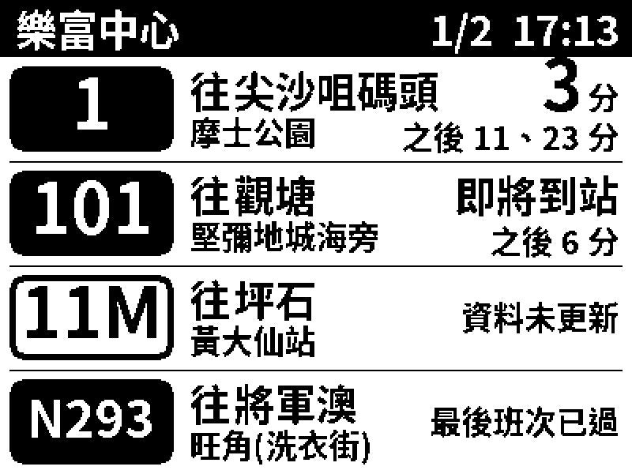

# ZECTRIX NOTE4 香港巴士到站顯示屏固件

把 ZECTRIX NOTE4（4.2 吋黑白墨水屏版）變成一個專門顯示香港巴士／小巴到站時間的小螢幕。
字大、對比高，適合放在家中門口給長者看。



## 功能

- 支援 **九巴（含龍運）、城巴、九巴＋城巴聯營線、專線小巴、新大嶼山巴士、港鐵巴士**
- 每分鐘自動更新一次；畫面只局部刷新有改動的部分，不會每分鐘黑白閃一次（每 30 分鐘做一次全屏刷新清殘影）
- 每頁 3 條（字更大）或 4 條路線，可加入最多 24 條，用側面的音量＋／－鍵翻頁或設定自動換頁
- 用手機開網頁設定：可按 **路線號碼**、**車站名稱** 搜尋，或直接 **貼上 hkbus.app 連結**
- 路線及車站資料與 hkbus.app 相同；目的地及車站名稱可以自己改（例如改成「去街市」）
- 首次使用以手機連接顯示屏自己的 Wi-Fi 設定（有密碼保護），螢幕上有 QR Code
- 設定頁需要螢幕上的 6 位設定碼，同一 Wi-Fi 的其他人不能更改設定
- 每日顯示時段（最多 3 段，例如早上及下午出門時間），時段外休息，按 Home 鍵可臨時顯示 10 分鐘
- 斷網超過 3 分鐘會顯示「資料未更新」，不會用舊資料倒數；另有電量低提示、時鐘

## 使用方法

### 1. 首次開機：設定 Wi-Fi

1. 開機後螢幕顯示「設定 Wi-Fi」、一個 Wi-Fi 名稱（例如 `HKBus-1A2B`）及 8 位數字密碼。
2. 用手機相機掃描螢幕上的 QR Code 即可自動連接；或在手機 Wi-Fi 設定中選 `HKBus-1A2B`，輸入螢幕上的密碼。
3. 手機一般會自動彈出設定頁；如沒有，用瀏覽器開啟 `http://192.168.4.1`。
4. 按「搜尋 Wi-Fi」，選擇家中 Wi-Fi，輸入密碼，按「儲存並連接」。顯示屏會重新啟動。

> 只支援 2.4 GHz Wi-Fi。

### 2. 加入巴士路線

1. 連上 Wi-Fi 後，螢幕會顯示「未設定車站」、一個網址（例如 `192.168.1.57`）、6 位設定碼和 QR Code。
2. 手機連回家中 Wi-Fi，**掃描 QR Code**（會自動帶上設定碼）；或在瀏覽器輸入該網址，再輸入設定碼。
   手機會記住設定碼，之後再開不用重新輸入。日後想再修改，長按 Home 鍵 1.5 秒，螢幕會再顯示 QR Code 及設定碼。
3. 在「加入路線」選擇其中一種方法：
   - **路線號碼**：輸入號碼 → 選方向 → 選你等車的車站
   - **車站名稱**：輸入站名 → 選車站 → 剔選要顯示的路線（一次加幾條最方便）
   - **hkbus.app 連結**：在 hkbus.app 打開路線並揀選車站，複製網址貼上
4. 可以用 ↑ ↓ 調整次序、「改名」修改顯示的文字、「刪除」移除。
   在「顯示設定」可以設定螢幕標題、每頁 3 或 4 條、自動換頁，以及每日顯示時段。
5. 按底部「儲存到顯示屏」。約 5 秒後螢幕更新。

第一次搜尋時手機會下載 hkbus.app 的路線資料（約 8 MB），之後會儲存在手機內。

### 3. 按鍵

| NOTE4 按鍵 | 功能 |
| --- | --- |
| 音量＋ / 音量－（側面） | 上一頁／下一頁 |
| Home 鍵（正面圓鍵）按一下 | 立即更新並全屏刷新（清除殘影）；在休息時段會臨時顯示 10 分鐘 |
| 長按 Home 鍵 1.5 秒 | 顯示設定資料（Wi-Fi、網址、設定碼及 QR Code）；此時按音量＋可重新設定 Wi-Fi，按 Home 鍵返回 |
| 長按音量－ 3 秒 | 清空螢幕並關機 |

> 源碼中這三個鍵沿用官方參考項目的名稱：OK = Home 鍵（GPIO0）、▲ = 音量＋（GPIO39）、▼ = 音量－（GPIO18）。

### 螢幕上的文字

| 顯示 | 意思 |
| --- | --- |
| `3 分` | 下一班車約 3 分鐘後到站 |
| `之後 11、23 分` | 再下兩班 |
| `即將到站` | 不足 1 分鐘便到站 |
| `最後班次已過` 等 | 巴士公司提供的訊息 |
| `暫無班次` | 巴士公司沒有提供到站時間 |
| `資料未更新` | 超過 3 分鐘未能取得新資料（例如斷網），為免誤導不再顯示舊時間 |
| 「休息中，暫停更新」 | 現在不在設定的顯示時段內 |
| 標題變成「網絡中斷，稍後重試」 | 未能連接網絡，會自動重試 |
| 黑底白字路線號碼 | 巴士 |
| 白底黑框路線號碼 | 專線小巴 |

## 安裝（一鍵安裝網頁）

用**電腦版 Chrome 或 Edge** 開啟：

**<https://kalocarol1021-ctrl.github.io/hkbus-note4/>**

網頁會一步步帶你完成，全部在瀏覽器內進行，不用安裝任何程式：

1. **連接**：用可以傳輸資料的 USB-C 線接上 NOTE4，按「連接」並選擇 `USB JTAG/serial debug unit`。
   網頁會自動檢查這是不是 NOTE4，以及原廠有沒有把裝置鎖上（鎖上的話會提示你停止）。
2. **備份原廠固件**：把整部 NOTE4（16MB）存成檔案，約 3–5 分鐘。檔案會下載到電腦，同時保存在瀏覽器內。
   **第一次安裝前一定要做**，消費版 NOTE4 的原廠固件沒有公開下載。
3. **安裝**：按「安裝」，約 1 分鐘。完成後螢幕會顯示「設定 Wi-Fi」。
4. **還原**（日後想用回原廠功能時）：選擇備份檔按「還原」。

連接不到時：拔走 USB，**按住正面的 Home 鍵不放再插上 USB**，約 2 秒後放手，再按「連接」。

## 更新固件

已安裝的顯示屏**不用再接電腦**：在手機設定頁「固件更新」按「檢查更新」，有新版本時按「更新並保留設定」。
顯示屏會顯示進度，約 1–2 分鐘後自動重新啟動，路線及 Wi-Fi 設定全部保留。
如新版本無法正常啟動，顯示屏會自動退回舊版本。

## 手動燒錄（後備方法）

每個版本的固件也放在 GitHub 的 [Releases](https://github.com/kalocarol1021-ctrl/hkbus-note4/releases)：
`hkbus-note4-vX.Y.Z-full.bin` 用 esptool 或 <https://espressif.github.io/esptool-js/> 燒到地址 `0x0`。
備份可用指令：
`python -m esptool --chip esp32s3 --port COM5 read_flash 0 0x1000000 note4_原廠備份.bin`

## 自行編譯

需要 ESP-IDF 5.4 或以上（已用 5.5.2 編譯測試）。

```bash
idf.py set-target esp32s3
idf.py build
idf.py -p /dev/ttyACM0 flash monitor     # Windows 用 COM3 之類，macOS 用 /dev/cu.usbmodem*
```

> ⚠️ 只適用於黑白墨水屏版 ZECTRIX NOTE4，不適用於 NOTE4C。燒錄會取代原廠固件。
> 想回復原廠功能，需要向 ZECTRIX 取得原廠固件重新燒錄。

如曾經在同一資料夾編譯過其他設定，先刪除 `sdkconfig` 再 `set-target`。

## 發佈新版本（維護者）

1. 修改 `main/app_main.cc` 的 `kVersion`（例如 `1.3.0`）並推送到 `main`。
2. 建立並推送相同版本的 tag：`git tag -a v1.3.0 -m "更新說明" && git push origin v1.3.0`
3. GitHub Actions（`.github/workflows/release.yml`）會自動編譯、建立 Release，並更新安裝網頁及
   `firmware/ota.json`。之後各顯示屏按「檢查更新」就會看到新版本。

首次使用前，要在 GitHub repository 的 **Settings → Pages** 把 Source 設為 **GitHub Actions**。

## 專案結構

```text
main/app_main.cc          主程式：畫面刷新策略、按鍵、每分鐘更新
main/net.cc               Wi-Fi、設定用熱點、時間同步
main/dns_server.cc        設定熱點的自動彈出頁面（captive portal）
main/http_fetch.cc        HTTPS 讀取（同一伺服器共用連線）
main/web_server.cc        手機設定網頁及 API
main/web/index.html       手機設定網頁
main/fonts/*.bin          中文點陣字型（思源黑體 HK 粗體 20/26/32px，數字 44/58px）
components/hkbus_core/    畫面版面、字型、到站資料解析（不依賴 ESP-IDF，可在電腦上測試）
components/zectrix_epd/   墨水屏驅動（原廠參考源碼，未改動）
components/zectrix_board/ 按鍵、電池等（原廠參考源碼，未改動）
main/ota.cc               網上自動更新（下載、SHA-256 校驗、出錯自動退回）
installer/                一鍵安裝及備份網頁（GitHub Pages）
scripts/make_site.py      組合安裝網頁、固件及 ota.json
.github/workflows/        CI 測試、自動發佈
tools/                    字型產生、手機設定頁模擬器
test/                     電腦上的單元測試及畫面預覽
```

## 在電腦上測試（不需要裝置）

```bash
# 解析及設定測試、輸出螢幕預覽圖（需要 ESP-IDF 內的 cJSON）
cmake -S test -B build-host && cmake --build build-host
./build-host/hk_host_test test/fixtures
./build-host/hk_preview main/fonts /tmp/screen      # 產生 /tmp/screen_*.pbm

# 在電腦瀏覽器試用手機設定頁
python3 tools/mock_device.py     # 然後開 http://localhost:8080/
```

## 資料來源

到站時間由顯示屏直接讀取 DATA.GOV.HK 上各巴士公司的公開 API；路線及車站清單來自
hkbus.app 項目整理的資料。本項目與各巴士公司、DATA.GOV.HK 及 hkbus.app 沒有關係，
到站時間僅供參考。

## 進階

- **重新產生字型**（例如想加入更多罕見字）：
  `python3 tools/make_charset.py routeFareList.min.json > tools/charset.txt`，然後用
  `tools/gen_font.py` 產生（指令見檔案開頭說明）。現有字型包括 Big5 常用字及所有
  香港巴士／小巴站名用到的字。
- **未支援**：港鐵、輕鐵、渡輪（設定頁不會列出）。
- 授權：MIT，詳見 `LICENSE` 及 `THIRD_PARTY_NOTICES.md`。
